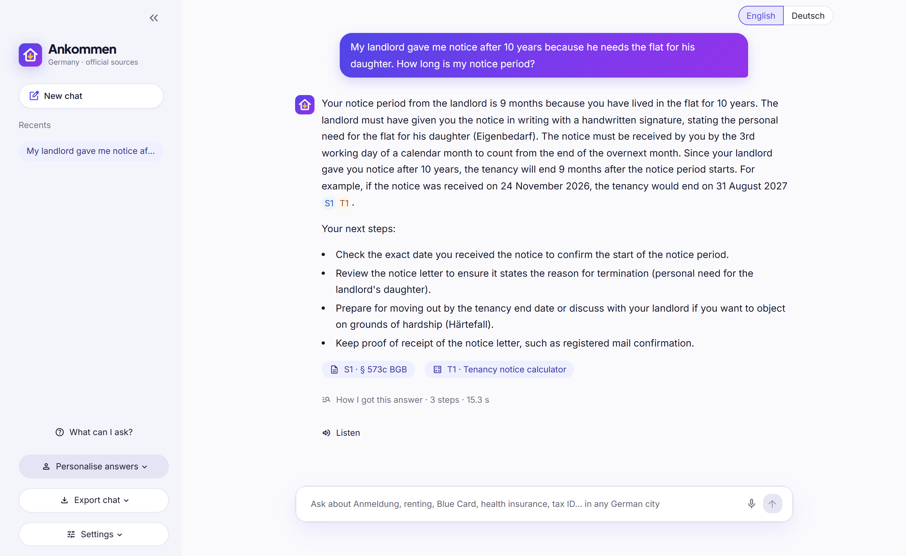
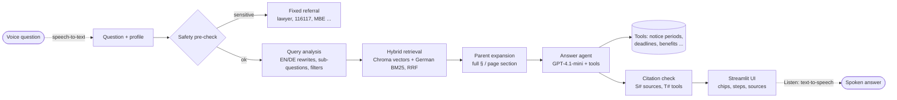

<p align="center">
  
</p>

<h1 align="center">Ankommen</h1>
<p align="center"><b>Your guide to settling in Germany</b> · <i>ankommen</i> = German for "to arrive, to settle in"</p>

An assistant that helps expats in **Germany** deal with registration, residence permits, renting, family benefits, health insurance, taxes (tax ID, tax classes), citizenship and driving licences: federal rules everywhere, plus local details for **Berlin, Hamburg, Munich, Cologne, Frankfurt and Stuttgart**. When the answer depends on the city and it is unknown, it asks. It answers **only from official German sources**, with clickable citations and "last verified" dates, and does date and benefit calculations with tested tools instead of guessing. You can type or **speak** your question, in **English or German**, and have the answer read aloud.

> **Live demo:** https://expat-assistant.streamlit.app/
>
> Turing College AI Engineering, Sprint 2: advanced RAG with query translation, structured retrieval and tool calling.
> ⚠️ General information only. **Not legal or tax advice.**



<details>
<summary>More screenshots: start screen, "How I got this answer"</summary>


</details>

## How it works



The index (Chroma + BM25 + parent store) is built locally from 78 official sources and shipped to the deployed app
as a versioned bundle ([ADR-0010](docs/adr/0010-deployed-index-bundle.md)). Every turn is traced in LangSmith.

## Highlights
- **Cross-lingual RAG:** English questions → German official sources (EN↔DE query rewriting, multi-query + RAG-Fusion, decomposition, step-back)
- **Structured retrieval:** rich metadata (domain, section kind, jurisdiction, audience, validity) with filters from the question *and* the user profile; § / Absatz-aware chunking with parent expansion
- **Hybrid search:** Chroma dense vectors + German BM25, fused with Reciprocal Rank Fusion
- **Location-aware:** rules for the city and state named in the question or the profile, never another city's; a
  one-click "Which city do you live in?" follow-up when it matters
- **Tool calling:** tenancy notice periods (§ 573c BGB), statutory deadlines (incl. what a late Kindergeld/Elterngeld application still gets), Kindergeld/Elterngeld estimates, document checklists, Schengen 90/180
- **Voice:** ask by microphone and press **Listen** to hear an answer. Speech becomes text and takes the same
  pipeline as a typed question, so citations and checks are identical; recordings are not stored
  ([ADR-0011](docs/adr/0011-voice-cascade-stt-tts.md))
- **English | Deutsch:** one switch sets the interface and the answer language
- **Evaluated:** golden dataset + LangSmith experiments (results below)
- **Safe by design:** safety pre-check (emergency, asylum, court cases, police letters, medical, tax forms) with
  fixed referrals; sources treated as data (prompt-injection hygiene); input validation and usage limits
- **Transparent:** citation chips, tool cards, "How I got this answer" timeline, tokens and cost per answer,
  chat export as PDF, Markdown, CSV or JSON
- **Guided:** a "What can I ask?" guide with topics, one-click example questions, tips for asking and the limits
- **Private:** the profile holds coarse categories only (no name, address or income); profile and chats live in
  the browser session and are never saved on the server

## Results

**Answer quality** (holdout: 32 questions never used for tuning, 6 cities + nationwide topics; judge: Claude Haiku 4.5; 2026-11-23)

| | Faithful | Correct | Valid citations | Tool selection | Refusal accuracy | Cost / answer |
|---|---|---|---|---|---|---|
| Naive RAG (R0) | 0.90 | 0.86 | 1.00 | 0.90 | 1.00 | ~$0.003 |
| **This system (R5)** | **0.92** | **0.96** | **1.00** | **1.00** | **1.00** | ~$0.003 |

**Germany-wide (85 questions, 6 cities + health insurance, taxes, citizenship, driving licence):** without location
filters, 54–56% of questions pulled another city's or state's rules into the top 10 results; with the per-question
location it is **0%** on dev and holdout (hit@5 0.94 dev / 0.96 holdout). The assistant asked "Which city do you
live in?" exactly when needed (100%).

**Judge calibration:** on 15 answers the correctness judge agreed with reference labels 12 times (80%, Cohen's
kappa 0.44). The reference labels came from a second model, with 3 of them confirmed by a human, so judge scores
are read as a trend and failures are checked by hand.

**Eval cost:** measured from the traces, the judge was 82% of the eval spend. New runs use a cheaper judge
(Gemini 2.5 Flash-Lite), short verdicts, a verdict cache and a spend guard: a full cycle went from ≈ $4.30 to
≈ $0.96 ([evaluation plan §5](docs/evaluation-plan.md#5-budget-measured-2026-11-23)). The numbers above are
from the Haiku 4.5 judge.

Retrieval ablation, before/after runs, failure analysis and known issues: [`docs/evaluation-plan.md`](docs/evaluation-plan.md).

## Tech stack

| Part | Choice |
|---|---|
| Language and tooling | Python 3.12, uv, Pydantic, ruff, mypy, pytest (480+ offline tests) |
| Models, all through OpenRouter ([ADR-0006](docs/adr/0006-openrouter-configurable-models.md)) | GPT-4.1-mini for query analysis and answers; Qwen3-Embedding-8B for embeddings, chosen by a bake-off ([ADR-0002](docs/adr/0002-embedding-model.md)); Whisper large v3 turbo for speech-to-text; Gemini 3.8 Flash Lite TTS for read-aloud |
| Retrieval | Chroma (embedded) + own German BM25 + Reciprocal Rank Fusion, parent store in SQLite |
| Orchestration and tracing | LangChain, LangSmith (EU region) |
| UI and hosting | Streamlit on Community Cloud: chat plus password-protected pages for retrieval debugging, the collection, evals and ingestion status |

Every model is a setting (`MODEL_ANSWER`, `MODEL_STT`, …), so swapping one is a config change plus an eval run.

## Cost protection
The app is public and paid from one API key, so Live answers are limited in layers: question length, 20 questions
per hour per session, 300 per day for the whole app, and a credit limit on the key itself. Read-aloud costs
several times a text answer, so it runs only on demand and has its own limits. Without a key or budget the app
falls back to **Demo mode** with scripted answers, so the link always works. Details: [`docs/deployment.md`](docs/deployment.md).

## Limitations
- Six cities have local sources; elsewhere the assistant uses federal and state rules and says so.
- Topics are registration, residence permits, renting, family benefits, health insurance, tax ID and tax
  classes, citizenship and foreign driving licences. Tax returns and individual tax or legal advice are out of
  scope (the assistant refers to a Steuerberater, Lohnsteuerhilfeverein or lawyer).
- Sources are snapshots with a "last verified" date; rules change, and the official German text is binding.
- Voice was smoke-tested live and tried by hand, but not measured on recordings with accents or background noise.
- The evaluation sets are small (85 questions, 32 of them holdout; 6–8 per new topic), so the numbers show
  direction, not precision.

## Quick start
```bash
uv sync                           # Python 3.12 + all deps
cp .env.example .env              # add OpenRouter + LangSmith keys
uv run pytest                     # offline unit tests
uv run expat-ingest               # fetch official sources -> data/processed/ (~3 min, polite crawl)
uv run expat-index                # embed + build Chroma, BM25 and the parent store
uv run streamlit run app/Home.py  # chat UI (switch "Live answers" on in Settings)
```
make-it-in-germany.com blocks scripted downloads: save its two pages by hand to
`data/manual/miig-blue-card.html` and `data/manual/miig-family-reunification.html`
(URLs in `sources.yaml`), then run `uv run expat-ingest --source miig-blue-card miig-family-reunification`.

## Project layout
```
app/          Streamlit chat (Home.py), admin pages, interface strings, demo pipeline
src/expat/    ingestion · store (Chroma, BM25, bundle) · rag (analysis, retrieval, generation) ·
              tools · evals · speech · safety · guards · config
rules/        versioned amounts and thresholds used by the tools (2026.yaml)
sources.yaml  registry of the official sources
evals/        golden questions and judge calibration
tests/        offline tests (network tests are marked and skipped by default)
docs/         plan, pipeline and database design, evaluation, deployment, decisions (ADRs)
```

## Docs
| | |
|---|---|
| Plan and architecture | [`docs/PLAN.md`](docs/PLAN.md) |
| Vector DB design | [`docs/vector-db-design.md`](docs/vector-db-design.md) |
| RAG pipeline | [`docs/rag-pipeline.md`](docs/rag-pipeline.md) |
| Tools | [`docs/tools.md`](docs/tools.md) |
| Evaluation | [`docs/evaluation-plan.md`](docs/evaluation-plan.md) |
| Deployment and limits | [`docs/deployment.md`](docs/deployment.md) |
| Decisions (ADRs) | [`docs/adr/`](docs/adr/) |

## Data and licensing
Statutes come from gesetze-im-internet.de (public domain, § 5 UrhG). Portal content is used for non-commercial educational purposes, with attribution and deep links. **Scraped content and the vector index are not committed.** Rebuild them locally with the ingestion CLI. See [`docs/data-sources.md`](docs/data-sources.md).
