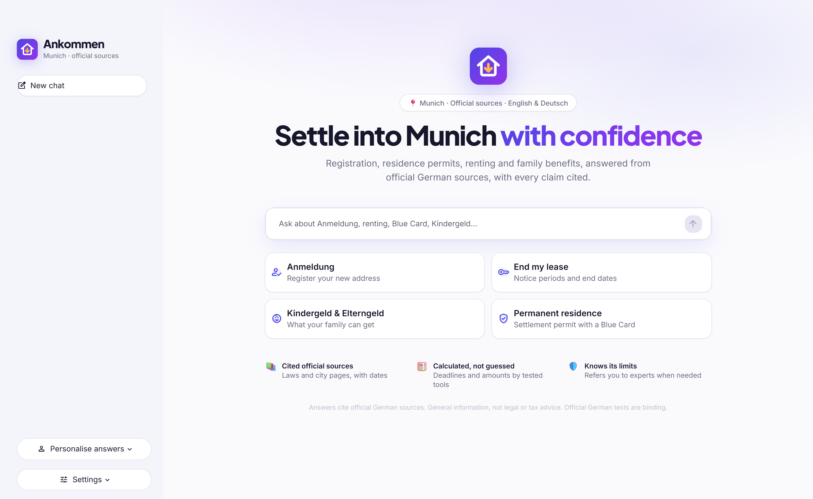
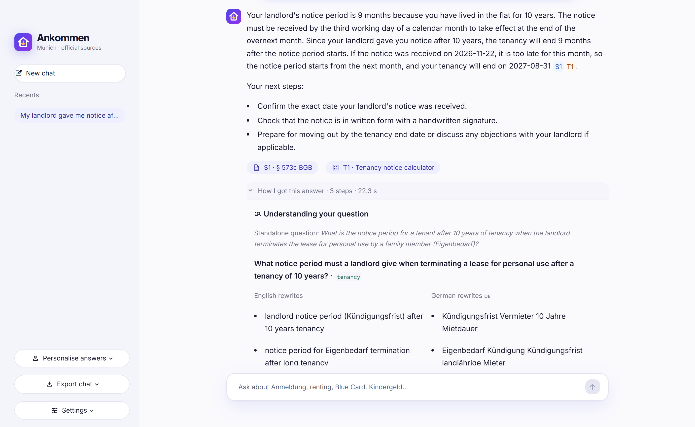
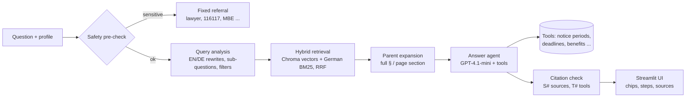

<p align="center">
  
</p>

<h1 align="center">Ankommen</h1>
<p align="center"><b>Your guide to settling in Munich</b> · <i>ankommen</i> = German for "to arrive, to settle in"</p>

An English-language assistant that helps expats in **Munich** (MVP persona: a non-EU Blue Card family) deal with registration, residence permits, renting and family benefits. It answers **only from official German sources**, with clickable citations and "last verified" dates, and does date and benefit calculations with tested tools instead of guessing.

> **Live demo:** https://expat-assistant.streamlit.app/
>
> Turing College AI Engineering, Sprint 2: advanced RAG with query translation, structured retrieval and tool calling.
> ⚠️ General information only. **Not legal or tax advice.**


<details>
<summary>More screenshots: start screen, "How I got this answer"</summary>



</details>

## How it works



The index (Chroma + BM25 + parent store) is built locally from official sources and shipped to the deployed app
as a versioned bundle ([ADR-0010](docs/adr/0010-deployed-index-bundle.md)). Every turn is traced in LangSmith.

## Highlights
- **Cross-lingual RAG:** English questions → German official sources (EN↔DE query rewriting, multi-query + RAG-Fusion, decomposition, step-back)
- **Structured retrieval:** rich metadata (domain, section kind, jurisdiction, audience, validity) with filters from the question *and* the user profile; § / Absatz-aware chunking with parent expansion
- **Hybrid search:** Chroma dense vectors + German BM25, fused with Reciprocal Rank Fusion
- **Tool calling:** tenancy notice periods (§ 573c BGB), statutory deadlines, Kindergeld/Elterngeld estimates, document checklists, Schengen 90/180
- **Evaluated:** golden dataset + LangSmith experiments (ablation table below)
- **Safe by design:** safety pre-check (emergency, asylum, court cases, police letters, medical, tax forms) with
  fixed referrals; sources treated as data (prompt-injection hygiene); input validation and usage limits
- **Transparent:** citation chips, tool cards, "How I got this answer" timeline, tokens and cost per answer,
  chat export as Markdown or JSON

## Results (holdout, 12 questions never used for tuning; judge: Claude Haiku 4.5)

| | Faithful | Correct | Valid citations | Refusal accuracy | Cost / answer |
|---|---|---|---|---|---|
| Naive RAG (R0) | 0.90 | 0.70 | 1.00 | 1.00 | $0.005 |
| **This system (R5)** | **1.00** | **0.90** | **1.00** | 0.92 | $0.005 |

Retrieval ablation, before/after runs, failure analysis and known issues: [`docs/evaluation-plan.md`](docs/evaluation-plan.md).

## Status
Deployed and evaluated (Nov 2026): live at https://expat-assistant.streamlit.app/. Plan and milestones: [`docs/PLAN.md`](docs/PLAN.md), [`docs/milestones.md`](docs/milestones.md).

## Quick start
```bash
uv sync                           # Python 3.12 + all deps
cp .env.example .env              # add OpenRouter + LangSmith keys
uv run pytest                     # offline unit tests
uv run expat-ingest               # fetch official sources -> data/processed/ (~3 min, polite crawl)
uv run expat-index                # embed + build Chroma, BM25 and the parent store
uv run streamlit run app/Home.py  # chat UI (toggle "Live mode" in the sidebar)
```
make-it-in-germany.com blocks scripted downloads: save its two pages by hand to
`data/manual/miig-blue-card.html` and `data/manual/miig-family-reunification.html`
(URLs in `sources.yaml`), then run `uv run expat-ingest --source miig-blue-card miig-family-reunification`.

## Docs
| | |
|---|---|
| Plan and architecture | [`docs/PLAN.md`](docs/PLAN.md) |
| Vector DB design | [`docs/vector-db-design.md`](docs/vector-db-design.md) |
| RAG pipeline | [`docs/rag-pipeline.md`](docs/rag-pipeline.md) |
| Tools | [`docs/tools.md`](docs/tools.md) |
| Evaluation | [`docs/evaluation-plan.md`](docs/evaluation-plan.md) |
| Decisions (ADRs) | [`docs/adr/`](docs/adr/) |

## Data and licensing
Statutes come from gesetze-im-internet.de (public domain, § 5 UrhG). Portal content is used for non-commercial educational purposes, with attribution and deep links. **Scraped content and the vector index are not committed.** Rebuild them locally with the ingestion CLI. See [`docs/data-sources.md`](docs/data-sources.md).
