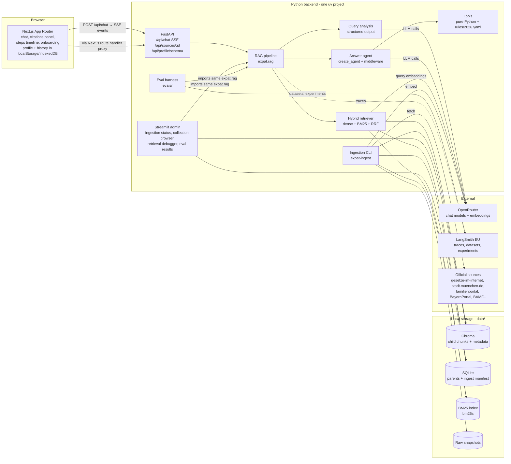

# Expat Germany Assistant: Project Plan

> Turing College AI Engineering, **Sprint 2**. Planning date: 2026-11-17. Target review: ~2026-12-01 (10 working days).
> **Elevator pitch:** an English-language assistant that helps a non-EU Blue Card family in Munich with registration, residence permits, renting and family benefits. It answers only from official German sources, with clickable citations and freshness dates, and does the date and benefit maths with verified tools instead of guessing.

## Document map

| # | Deliverable | File |
|---|---|---|
| 1 | Overview, scope, architecture | **this file** |
| 2 | Architecture diagram | [§ Architecture](#architecture) below |
| 3 | Data source inventory | [`data-sources.md`](data-sources.md) |
| 4 | Vector DB design | [`vector-db-design.md`](vector-db-design.md) |
| 5 | RAG pipeline (+ diagram), profile, safety | [`rag-pipeline.md`](rag-pipeline.md) |
| 6 | Tool specs | [`tools.md`](tools.md) |
| 7 | API contract | [`api-contract.md`](api-contract.md) |
| 8 | Repo structure | [`repo-structure.md`](repo-structure.md) |
| 9 | Evaluation plan | [`evaluation-plan.md`](evaluation-plan.md) |
| 10 | Milestones (day-by-day) | [`milestones.md`](milestones.md) |
| 11 | Risks and open questions | [`risks.md`](risks.md) |
| 12 | ADRs | [`adr/`](adr/) |
| + | Reviewer questions | [`review-prep.md`](review-prep.md) |

## Decisions so far

| Topic | Decision |
|---|---|
| Timeline | 10 working days (18 Nov → 1 Dec 2026) |
| LLM access | **OpenRouter** via `langchain-openrouter` (`ChatOpenRouter`). Three configurable roles: analysis / answer / judge |
| Budget | $10–30 total. Expected spend ≈ $5–10 (see `evaluation-plan.md` §4) |
| City / persona | **Munich (Bavaria)**. Primary persona: **non-EU EU-Blue-Card holder, married, 2 children, renting** |
| Backend | Python 3.12, uv, FastAPI, LangChain 1.x, Chroma (local, persistent), LangSmith (EU region) |
| Frontends | ~~Next.js + Streamlit admin~~ → **Streamlit primary** (chat + admin pages), **deployed** on Streamlit Community Cloud (ADR-0009, 2026-11-17). FastAPI + Next.js are stretch goals. |
| Repo layout | Single uv project at the repo root: `src/expat/` (package), `app/` (Streamlit), `evals/`, `tests/`, `rules/`, `sources.yaml` |

## Course requirements mapping

| Brief requirement | Status | Where it's met |
|---|---|---|
| Advanced RAG with **query translation** | **Required** | Cross-lingual EN↔DE rewriting, multi-query + RRF, decomposition, step-back (`rag-pipeline.md` §1) |
| **Structured retrieval** | **Required** | Metadata schema + profile- and question-derived filters, `section_kind` structure, parent-child (`vector-db-design.md` §4, `rag-pipeline.md` §3) |
| **Tool calling** for practical tasks | **Required** | 5 tools incl. structured-output checklist (`tools.md`) |
| Specific domain | **Required** | German bureaucracy for expats, Munich |
| Detailed, context-aware responses | **Required** | Profile + history + citations + next steps |
| LangChain | **Required** | LCEL/structured output, `create_agent` + middleware, retrievers (langchain-core interfaces) |
| Streamlit **or** Next.js | **Required** (one of them) | Next.js is the product UI. Streamlit is extra (admin) |
| Vector database | **Required** | Chroma |
| Polished UI | **Expected** | Claude-style Next.js chat |
| Evaluation with numbers, LangSmith tracing | Not in the brief, **strongly recommended** | `evaluation-plan.md`. This is what turns "I built RAG" into "I proved it works" |
| Hybrid search, reranking, admin console | Nice-to-have | Hybrid = MVP (cheap, big gain). Rerank = stretch. Admin = 2 pages MVP |
| Deployment | Check the rubric (open question) | Stretch |

## MVP scope vs stretch

### Domains: depth over breadth

| Phase | Domains | Why |
|---|---|---|
| **MVP (deep)** | **1. Bureaucracy** (Anmeldung, Blue Card/residence in Munich, Rundfunkbeitrag) · **2. Tenancy** (BGB rental law, Munich Mietpreisbremse/Kappungsgrenze/Mietspiegel) · **3. Family** (Kindergeld, Elterngeld, Kita Munich) | All three hit the persona on day 1 in Germany. They cover all **document types** (law XML, procedure pages, FAQs, checklists, tables), so the vector DB design gets exercised fully. Tenancy gives the law-heavy, §-precise questions where hybrid search shines. Family gives numbers where tools shine |
| Stretch 1 | **Taxes** (Steuerklassen, ELSTER basics, Anlage N) | High relevance for Blue Card couples, but sources have stricter terms (BMF crawl-delay 180 s) and it's a domain where wrong answers hurt |
| Stretch 2 | **Travel** (Schengen, visas for visiting parents) | The Schengen tool already exists in the MVP. Only sources are needed |
| Later | Finance (GKV/PKV, pension), broader Law, other cities | DRV forbids storage, so link-only. Other cities = add `sources.yaml` entries (the design is city-agnostic) |

### MVP feature list
- Ingestion of ~8 sources (`data-sources.md`) → ~1.5–3k chunks, idempotent, with freshness metadata.
- QueryAnalysis (rewrite EN/DE, multi-query, decomposition, step-back, routing, filters) → hybrid retrieval (Chroma + BM25, RRF) → parent expansion → cited answer.
- Tools: tenancy notice, deadlines, family benefits, document checklist (structured output), Schengen (cuttable).
- FastAPI SSE streaming. Next.js chat with citations, step visualisation, onboarding and disclaimer.
- Streamlit: retrieval debugger + eval results (+ collection browser if time allows).
- Golden set of 30–50 questions. Retrieval ablations R0–R5. Answer evals (naive vs advanced). Results table in the README.

### Stretch goals
Reranker (R6) · Taxes domain · rent-increase checker tool · letter drafter · English parent summaries (multi-vector) · HyDE ablation (R7) · feedback 👍/👎 → LangSmith · office finder · deployment · conversation search. Ordered list in `milestones.md`.

## Architecture

**Key architectural properties (memorise these for the review):**
1. **One retrieval code path.** The API, the Streamlit debugger and the eval harness all call `expat.rag`. Eval numbers describe what users get.
2. **Deterministic retrieval, agentic tools.** Retrieval always runs (reproducible, evaluable). The answer agent autonomously decides about tools. This evolves into a full agent in Sprint 3.
3. **Numbers never come from the LLM.** They come from cited sources or from tools backed by a versioned rules file.
4. **Stateless backend, privacy by design.** No user data stored server-side. The profile is coarse enums.
5. **Everything swappable by config.** Models, embedding collection and retrieval flags (for ablations) are all config values.

## UI plan

### Next.js main app (Claude-style)
| Feature | Implementation notes | MVP |
|---|---|---|
| Layout: sidebar (conversations) + chat | shadcn/ui, Tailwind. Conversations in IndexedDB | ✅ (sidebar can be cut) |
| Streaming | `fetch` + `ReadableStream` SSE parser (`lib/sse.ts`), typed events generated from the Pydantic JSON Schema | ✅ |
| Markdown | `react-markdown` + `remark-gfm` + a custom remark plugin turning `[S1]` into `<CitationChip>` | ✅ |
| Citation chips → source panel | Sheet/drawer: title, § reference, source name, link, **verified date**, the parent text with the matched child highlighted, "official German text is binding" note, EN link if any | ✅ |
| "How I got this answer" | Collapsible timeline from `step` events: query analysis (show the EN/DE rewrites + sub-questions), retrieval (top hits per sub-question), tool cards (args → result), generation. **Your frontend differentiator.** Make it beautiful | ✅ |
| Onboarding | Form generated from `/api/profile/schema`, 6 optional fields, "skip" allowed, editable via a profile pill in the header | ✅ |
| Disclaimer | Persistent footer line + first-run modal | ✅ |
| Example prompts | Empty state with 4 persona questions (great for the demo) | ✅ |
| 👍/👎, copy, regenerate | Feedback → LangSmith | stretch |

### Streamlit admin/debug console: is the split a good idea?

| Option | Pros | Cons |
|---|---|---|
| Next.js only | One UI, less work | Debug tooling in React is slow to build. You'd skip it, and lose your best review demo (the retrieval debugger) |
| Streamlit only | Fastest, the course-standard route | Doesn't showcase your senior frontend strength. Hard to make it "polished" and Claude-like |
| **Next.js product UI + thin Streamlit admin** ✅ | Each tool for its job: the product UI shows frontend craft, and Streamlit gives Python-native internal tooling in ~1 hour per page, importing the same pipeline. Shows you know the product/internal-tool split | Two UIs to maintain. Mitigated by keeping Streamlit to 2–3 pages and building it *after* the vertical slice |

**Recommendation:** do the split, but with a strict budget: the **retrieval debugger** (query → analysis → per-variant ranks → fused results with scores, filters and metadata) and **eval results** pages are MVP. The collection browser and ingestion status are cuttable. The brief says "Streamlit **or** Next.js", so Next.js alone satisfies the requirement and Streamlit is a bonus. (ADR-0003)

## Budget estimate
| Item | Estimate |
|---|---|
| Embeddings (bake-off 3 models + re-ingests) | < $0.20 |
| Dev chat traffic (~500 turns × ~0.3 ¢) | ~$1.50 |
| Retrieval evals (~10 sweeps) | ~$2 |
| Answer evals with judge (~5 sweeps) | ~$3–8 |
| **Total** | **≈ $7–12**, within the $10–30 budget |
| LangSmith | Free Developer tier: 5k traces/month, 14-day retention. **Export experiment results** (`report.py` → markdown) so numbers survive the retention window |
