# Vector Database Design

> The core of the project. Library facts were verified on 2026-11-17: `chromadb` 1.5.x, `langchain-chroma` 1.1.0, `langchain` 1.5, `langchain-classic` 1.0.x.
> Key findings that shaped this design:
> - Chroma's built-in BM25/sparse **hybrid search + RRF is Chroma Cloud only**. Local Chroma does dense vectors only, so we build BM25 ourselves.
> - Chroma **metadata arrays** exist since Feb 2026 (`$contains`), but local support is not documented. **Spike on Day 2**, with a fallback.
> - `langchain-community` (home of `BM25Retriever`, `HuggingFaceCrossEncoder`) was **sunset in May 2026**, so we don't depend on it.

---

## 1. Collection strategy

| Option | Routing | Filtering | Eval | Scaling | Verdict |
|---|---|---|---|---|---|
| **A. One collection, rich metadata** | Routing = a `where={"domain": {"$in": [...]}}` filter. Multi-domain questions need **one** query | Any combination of filters (domain × jurisdiction × audience × source_type) | One index to evaluate. Ablations toggle filters | Fine up to millions of chunks (HNSW). One embedding model for all | ✅ **Recommended** |
| B. One collection per domain | Router must pick collections. Multi-domain = N queries + merge. Misrouting = **zero recall** (hard failure) | Cross-domain filters are impossible | Per-domain metrics are easy, global ones harder | Many small indexes. Overlapping content (e.g. Kindergeld is family *and* tax) gets duplicated | ❌ |
| C. Hybrid (per *type* collections, e.g. laws vs guides) | Lets you use different embedding models per type | Two queries + fusion | More moving parts | Only worth it at scale or with very different content | ❌ for MVP. Mention as future work |

**Decision:** **one Chroma collection for child chunks** + a **separate parent store** (SQLite) + a **separate BM25 index** built from the same chunks.

- Routing becomes a **soft or hard filter**, not a physical partition. When the router is unsure, we drop the domain filter. With B, a routing mistake is unrecoverable.
- **Collection name encodes the embedding model + schema version:** `expat__qwen3-emb-8b__s1`. The bake-off creates one collection per candidate model from the same chunks. Switching models means switching a config value, and old collections stay available for A/B comparison.
- **Why not store parents in Chroma too?** Parents are never searched by vector. A key-value store (SQLite table `parents(parent_id PK, text, metadata_json)`) is simpler and keeps the vector index clean.

## 2. Data point / document types

| `source_type` | Examples | Structure signal | Typical source |
|---|---|---|---|
| `law` | § 573c BGB, § 18g AufenthG, § 17 BMG | `<norm>` → `enbez` (§) → `
` (Absatz) | gesetze-im-internet XML, verkuendung-bayern |
| `guide` | "Blue Card explained", Elterngeld overview | H1–H4 headings | familienportal, BAMF, make-it-in-germany |
| `procedure` | "Wohnsitz anmelden" (Munich), BayernPortal "Leistung" pages | Fixed sections: *Beschreibung, Voraussetzungen, Unterlagen, Fristen, Kosten, Rechtsgrundlage* | stadt.muenchen.de, BayernPortal |
| `faq` | Kindergeld FAQ, kitafinder FAQ | Q/A pairs (accordion `
`/`dt-dd`) | familienportal, kitafinder |
| `checklist` | Required documents for Anmeldung / Blue Card | `<ul>` under "Unterlagen"/"Required documents" | procedure pages |
| `table` | Fees, Elterngeld rates, Mietspiegel summary | `<table>` | various |
| `regulation` | Bavarian Mieterschutzverordnung (municipality list, validity) | § + Anlage | verkuendung-bayern |

`procedure` pages are split into **section kinds** (`section_kind` ∈ `overview | requirements | documents | deadlines | fees | steps | legal_basis | contact`). This gives structured retrieval cheaply: "How much does a Blue Card cost?" → `section_kind ∈ {fees}` boost. It is the strongest "structured retrieval" story for the review.

## 3. Chunking strategy per type

Global rules:
- **Never cross a structural boundary** (§, heading, Q/A, table). Overlap applies only *within* a section.
- Sizes are in **tokens** (`tiktoken`; German tokenises ~1.3× denser than English, so measure, don't count characters).
- Each chunk gets a **contextual header** prepended to the text that is embedded and BM25-indexed:
  `"[BGB › § 573c Kündigungsfristen › Abs. 1] [tenancy] "`
  This "contextual chunk header" technique resolves the "Abs. 2 says '…this period…' but which law?" problem and costs nothing.
- **Parent-child (small-to-big):** search over small **children**, then return their **parent** to the LLM. The mapping is built by our own parsers (structure-aware), so we don't use the generic `ParentDocumentRetriever` (`langchain_classic`, which uses generic text splitters). We implement the same idea with `parent_id` in metadata + a SQLite lookup (~20 lines, fully explainable).

| Type | Child chunk (searched) | Parent (sent to LLM) | Size target | Overlap | Notes |
|---|---|---|---|---|---|
| `law` | One **Absatz** (`
`). If the whole § < 350 tok, child = whole § | The whole **§** (cap 1,500 tok; huge §§ are split by Absatz groups) | 80–400 | 0 (Absätze are self-contained; the header carries context) | `legal_reference = "§ 573c Abs. 1 BGB"`. Exact § strings are critical for BM25. Footnotes/"(weggefallen)" norms are skipped |
| `guide` | Paragraph group within an H3 (or H2 if no H3) | The **H2 section** | 200–400 | 50 tok (within the section) | Drop nav, footers, cookie banners, "related links". Lists stay attached to their lead-in sentence |
| `procedure` | One **section_kind** block | The whole procedure page (≤ 2,000 tok, else the section) | 100–500 | 0 | Highest-value type. `section_kind` set from heading text via a DE/EN keyword map |
| `faq` | One **Q+A pair** | The same (child = parent) | 50–500 | 0 | If the answer > 500 tok, split the answer and **repeat the question** in each child |
| `checklist` | The **whole list intact** | The procedure page | ≤ 700 | 0 | Splitting a document list loses "you need *all* of these" |
| `table` | Table as **Markdown, intact** (split by row groups with the **header repeated** if > 600 tok) | Same section | ≤ 600 | 0 | Embed text = title + column headers + row labels + the Markdown (numbers embed poorly, labels embed well) |
| `regulation` | § / Anlage entry | § | like `law` | 0 | Municipality lists: one chunk listing municipalities + `valid_until` metadata |

**Why these sizes:** small, focused children give sharp embeddings and precise citations ("§ 573c Abs. 1"). Parents give the LLM enough surrounding context to answer correctly (Absatz 2 often modifies Absatz 1). This is the precision/context trade-off reviewers ask about. **Validate it on Day 4:** a quick ablation of child-only vs parent-expanded context on answer faithfulness.

## 4. Metadata schema

Pydantic model `ChunkMetadata` (validated **before** upsert, so a bad chunk never reaches the index):

| Field | Type | Example | Purpose |
|---|---|---|---|
| `chunk_id` | str | `sha1(doc_id + structural_path + idx)[:16]` | Deterministic ID → idempotent upsert |
| `parent_id` | str | `bgb#573c` | Parent lookup |
| `doc_id` | str | `sha1(canonical_url)[:16]` | All chunks of one source doc (delete/replace) |
| `doc_key` | str | `bgb#573c`, `muc:anmeldung#documents` | **Stable human-readable key for evals** (survives re-chunking) |
| `doc_version` | str | content hash of the cleaned doc `[:12]` | Versioning, change detection |
| `content_hash` | str | sha1 of the chunk text | Skip re-embedding unchanged chunks |
| `domain` | str | `tenancy` | Routing filter |
| `subtopic` | str | `notice_period` | Finer routing, admin browsing |
| `source_type` | str | `law \| guide \| procedure \| faq \| checklist \| table \| regulation` | Type-specific boosts |
| `section_kind` | str | `documents` | Structured retrieval (procedures) |
| `source_name` | str | `Gesetze im Internet` | Citation display |
| `source_url` | str | deep link (`…/bgb/__573c.html`) | Citation link |
| `title` | str | `Kündigungsfristen` | Citation display |
| `heading_path` | str | `BGB › Buch 2 › Abschnitt 8 › § 573c` | Citation + contextual header |
| `legal_reference` | str | `§ 573c Abs. 1 BGB` (empty if none) | Citations, BM25 boost, § validator |
| `language` | str | `de` | Language-aware query selection |
| `alt_lang_url` | str | EN page URL if one exists | "Read in English" link |
| `is_machine_translated` | bool | `true` for stadt.muenchen.de EN | Trust signal |
| `jurisdiction` | str | `federal \| state \| city` | Structured filter |
| `state` | str | `BY` (empty for federal) | Profile filter |
| `city` | str | `munich` (empty unless city-level) | Profile filter |
| `applies_to` | **list[str]** (or flags, see below) | `["non_eu", "employee", "family"]`, or `["all"]` | Audience filter |
| `last_verified` | str (ISO date) | `2026-11-18` | Display |
| `last_verified_ts` | int (epoch days) | `20410` | **Numeric** range filters (Chroma `$gte` only works on numbers) |
| `valid_from` / `valid_until` | str (ISO) + `_ts` ints | `2026-01-01` / `2029-12-31` | Exclude expired rules |
| `token_count` | int | `212` | Context budgeting |
| `embedding_model` | str | `qwen/qwen3-embedding-8b` | Safety check: query and index models must match |
| `schema_version` | int | `1` | Migrations |

### Handling the list field `applies_to`

| Option | Filter for a non-EU employee | Pros | Cons |
|---|---|---|---|
| **A. Native metadata arrays** (Chroma ≥ 1.5, Feb 2026) | `{"$or": [{"applies_to": {"$contains": "non_eu"}}, {"applies_to": {"$contains": "all"}}]}` | Clean, matches the domain model | Local support undocumented. `$not_contains` partially unsupported. **Spike on Day 2** |
| **B. Boolean flags** | `{"$or": [{"aud_non_eu": true}, {"aud_all": true}]}` | Works in every Chroma version, trivially explainable | Schema grows with each audience (~8 flags, acceptable) |
| C. Delimited string `"\|non_eu\|employee\|"` | Needs `where_document`-style substring matching, which metadata filters don't support | — | ❌ |

**Recommendation:** try A on Day 2 (a 10-minute test). If it works locally, use it. Otherwise use B. Either way, `filters.py` hides the representation behind `audience_filter(profile)`, so the rest of the code doesn't care. This is a good review point: *"I verified the capability instead of trusting the changelog, and isolated the decision behind one function."*

### Hard vs soft filters (important)
Over-filtering kills recall: most federal guides apply to everyone, and audience tags are imperfect.
- **Hard filters** (in `where`): `valid_until_ts >= today` and `city ∈ {"munich", ""}` (excludes *other* cities only).
- **Soft signals** (re-scoring after retrieval): audience match +, domain match +, `section_kind` match +.
- Domain routing is hard only when the router's confidence is high. Otherwise there is no domain filter.

The R5 ablation in the evals measures exactly this.

## 5. Embedding model

Requirement: an **English question must retrieve a German chunk** (cross-lingual), plus German↔German.

| Model (via OpenRouter `/api/v1/embeddings`) | Dims | MMTEB (multilingual) | $/1M tok | Local option | Notes |
|---|---|---|---|---|---|
| `qwen/qwen3-embedding-8b` | 4096 (MRL) | **70.6** | **$0.01** | Yes (Apache-2.0, needs a GPU) | Top multilingual scores, cheapest. Uses an **instruction prefix for queries** |
| `qwen/qwen3-embedding-4b` | 2560 | 69.5 | $0.02 | Yes | Smaller variant |
| `baai/bge-m3` | 1024 | 59.6 | $0.01 | **Yes, runs on CPU** (568M) | Robust cross-lingual, 8k context. Also produces sparse vectors (future hybrid) |
| `intfloat/multilingual-e5-large` | 1024 | ~58–63 | $0.01 | Yes (CPU) | Needs `query: ` / `passage: ` prefixes |
| `openai/text-embedding-3-small` | 1536 | n/a (lower) | $0.02 | No | The common baseline. Most tutorials use it |
| `openai/text-embedding-3-large` | 3072 | 58.9 | $0.13 | No | Expensive for no multilingual gain |

MMTEB figures are from the Qwen3 model card (mid-2025 snapshot). Use them as a prior, not as truth for *your* corpus.

**Cost reality check:** the corpus is ~2k chunks × ~300 tok ≈ 0.6M tokens, so **embedding everything costs ≈ $0.01 per model**. Cost doesn't decide this. Quality on *your* data, latency, and operational simplicity do.

**Recommendation going in:** `qwen/qwen3-embedding-8b` via OpenRouter (hypothesis), challenged by `bge-m3` and `text-embedding-3-small`. **The bake-off decides** (ADR-0002).

**Bake-off design (Day 3, ~2 hours):**
1. Build three collections from identical chunks (`expat__<model>__s1`).
2. Run the golden set (30 questions) with the **R0 config**: raw query, vector only, no filters, k=10.
3. Metrics: hit@5, MRR@10, plus a **cross-lingual gap**: run each English question *and* its German translation, and report `hit@5(DE) − hit@5(EN)`. A small gap means the model is truly cross-lingual. A big gap means rewriting matters more, which is also a finding.
4. Also record query latency p50 (API round-trip) and indexing time.
5. Decide with a written result in ADR-0002. Tie → choose the cheaper/simpler option.

Gotchas to handle in code:
- Qwen3 queries need `"Instruct: Given a question, retrieve German administrative or legal passages that answer it\nQuery: {q}"`. Documents get no prefix. E5 needs `query:` / `passage:`. Wrap this in a small `EmbeddingAdapter` so every model gets its correct prefixes.
- LangChain: `langchain-openrouter` has **no embeddings class**. Use `OpenAIEmbeddings(model=…, base_url="https://openrouter.ai/api/v1", api_key=…, check_embedding_ctx_length=False)`. Verify this on Day 1. If it fails, write a 20-line `Embeddings` subclass calling the endpoint with `httpx`.
- Store `embedding_model` in the collection metadata and **assert at query time** that it matches the query embedder.

## 6. Ingestion pipeline

```mermaid
flowchart LR
  S[sources.yaml] --> F[Fetch<br/>robots.txt, rate limit,<br/>ETag/If-Modified-Since]
  F --> R[(data/raw<br/>timestamped snapshots)]
  R --> P[Parse by parser type<br/>law_xml / guide_html /<br/>procedure_html / faq_html / pdf]
  P --> C[Clean + normalise<br/>strip nav, normalise ¶/§ whitespace,<br/>to Markdown]
  C --> L[Language check<br/>lingua per section]
  L --> K[Chunk per source_type<br/>children + parents]
  K --> E[Enrich metadata<br/>doc_key, legal_reference, section_kind,<br/>audience, validity, contextual header]
  E --> V{Validate<br/>ChunkMetadata}
  V -- invalid --> Q[(quarantine.jsonl<br/>+ report)]
  V -- ok --> D{content_hash<br/>changed?}
  D -- no --> T[touch last_verified only]
  D -- yes --> M[Embed changed chunks<br/>batched]
  M --> U[Upsert Chroma<br/>+ parents in SQLite]
  U --> O[Delete orphans<br/>chunks of old doc_version]
  O --> B[Rebuild BM25 index]
  B --> N[(manifest: doc_id, version,<br/>fetched_at, counts, status)]
```

**Idempotency and versioning:**
- **Deterministic IDs:** `chunk_id` = hash(doc_id + structural path + index). Re-running produces the same IDs, and `collection.upsert()` overwrites them.
- **Change detection at two levels:** `doc_version` (whole cleaned document) → skip the document entirely if unchanged. `content_hash` (chunk) → re-embed only changed chunks.
- **Orphan cleanup:** after upserting a document's new version, delete chunks `where={"doc_id": X, "doc_version": {"$ne": new}}`.
- **Deduplication:** the same text appears on several pages (e.g. the Kindergeld amount on familienportal and BayernPortal). Exact duplicates (same `content_hash`) keep one chunk and record the other URLs in `also_at`. Near-duplicates (optional: MinHash/cosine > 0.97) get logged in the Day 9 report rather than auto-removed.
- **Manifest** (SQLite `ingest_runs`, `documents`): the Streamlit "Ingestion status" page reads it (source, last fetch, status, #chunks, changed?).
- **Re-runnable CLI:** `expat-ingest --source bgb`, `--all`, `--due` (by `refresh` cadence), `--rebuild-collection <model>` (bake-off).
- **Determinism test:** run twice, then assert the counts and IDs are identical (Day 2 "done" criterion).

Library choices (no `langchain_community`):
- Fetch: `httpx` + `urllib.robotparser`. HTML: `selectolax` or `BeautifulSoup` + `markdownify`. XML: `lxml`. PDF: `pymupdf`.
- Language: `lingua-language-detector` (accurate on short German/English passages).
- BM25: **`bm25s`** with a **German Snowball stemmer (`PyStemmer`)**, wrapped in our own `BaseRetriever` (langchain-core). Decompounding (Mietpreisbremse → Miet+preis+bremse) is a stretch. Note it in the review as a known BM25 weakness on German.
